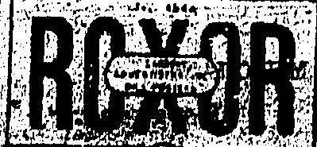
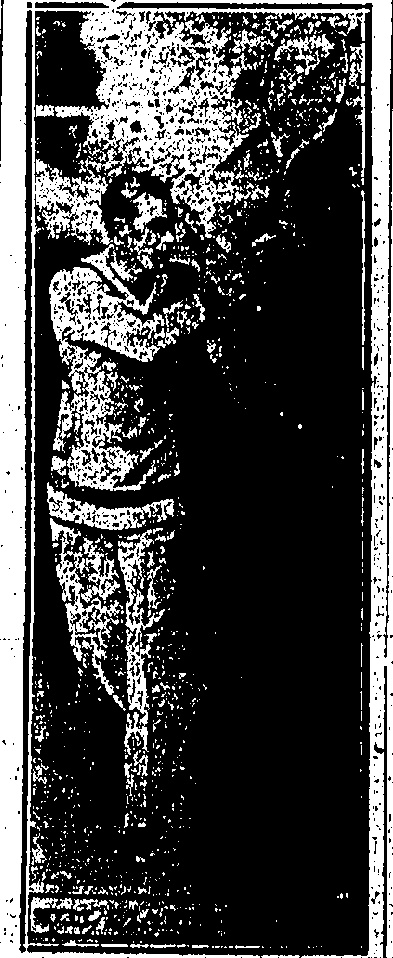
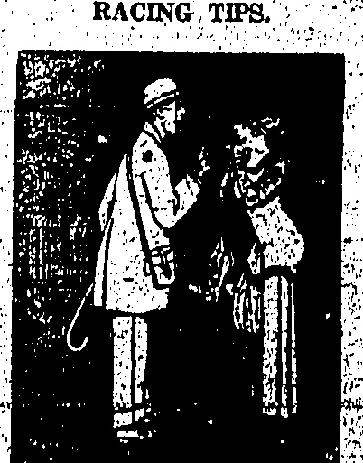

# “CHINA MAIL” SPORTS PAGE.

# THE CHINA MAIL.

## LAWN BOWLS

## LOCAL NOTES AND COMMENT

## LEAGUE PROSPECTS

The following are the league games down for decision tomorrow:—

Tnikoo R.C. v. Kowloon Dock R.C.

Kowloon C.C. v. Kowloon B.G.C.

Civil Service C.C. v. Craigen-

gower C.C.

SECOND DIVISION.

Police R.C. v. Taikoo R.C.

Indian R.C. v. Kówloon C.C.

East Point R.C. v. R.H.K.

Yacht Club.

The games are down to start at 3.30 p.m. sharp on the ground of the first-named and the results in the first division will be awaited with interest.

Taikoo are at home to the Kowloon Dock team and they will be anxious to average their defeat at Kowloon. Playing at home they will have an advantage and are likely to turn the tables on their opponents to-morrow. They still have a chance to become league champions, but they will need to win all their remaining engagements.

With such a creditable win in their favour, over Taikoo last week, it is evident the Bowling Green Club have found their form; although they will be playing away from home, I rather think they will be too good for the Cricket Club and may return home with the points.

Craigengower had a splendid victory away from home last week and to-morrow they visit the Civil Service who have yet to be beaten on their own ground. It will be necessary for the former to win to-morrow if they wish to retain their position at the head of the league.

In the second division the Police receive Taikoo and as they succeeded against this team away from home earlier in the season, it hardly seems possible for them to fail at home. However, the Police Green is one that any bowler can play on and the result seems open. Should they win to-morrow, the Police are pretty certain of the junior league championship and an immediate return to senior circles.

The Indians are at home to the Kowloon Cricket Club and I do not think the latter are strong enough to take the unbeaten home record away from the Indians. They had very hard luck at Taikoo last week for after being five up on the eighteenth head they lost by one.

The East Point Club—have as their guests the Yacht Club. Both Clubs have yet to register a win and the losers to-morrow seem doomed to be the “wonder spoonists” for this season.

## * * * * *

Nothing seems to have been done since the decision to run the open championship singles on the new lines. I have not heard of any club starting their preliminary rounds yet. There does not seem to be much enthusiasm in the competition this year.

Now it is definitely known that Shanghai are sending down an Interport team towards the end of September, it behaves the selection committee to get busy. A few trial games, "probables v. "Possibles," should be arranged, and every player of reasonable ability should be given a chance.

It will also be necessary for the team that is picked to represent the Colony to get some practice together, and they should play against a team chosen from "The Rest."

Both the above suggestions I commend to the consideration of those responsible for the arrangements that are to be made.

The first round in the junior golf championship at Happy Valley has to be completed by Monday.

## STILL, WINNING

## LANCASHIRE'S CRICKET VICTORY

Lancashire visited Swansea and defeated Glamorgan, in two days by 138 runs. Scores:—

Lancashire 141 (Mercer, J., 6. wickets for 52 runs).

Glamorgan 110 (Macdonald, E. A., 5 wickets for 38 runs; Tyldesley 5 for 35).

Lancashire 279 for 5 wickets declared (Hallows, C., 108; Watson, F., 60 not out).

Lancashire, of course, remains at the head of the table. Results of matches now being completed will be published in to-morrow's "China Mail" together with the table up-to-date.

Glamorgan 172 ((Macdonald 5 or 59).

All the counties excepting Northants will be engaged in the matches which commence tomorrow. Of these the most important are those between Middlesex and Lancashire, Yorkshire and Notts. The full list is: Lord's—Middlesex v. Lancashire

Oval—Surrey v. Essex.

Sheffield—Yorkshire v. Notts.

Southampton — Hampshire v

Warwickshire.

Worcester—Worcestershire Glamorgan.

Horsham—Sussex v. Somerset.

Leicester — Leicestershire v.

Gloucestershire.

Tonbridge — Kent v. Derby.

shire.

Oxford—University v. Free Foresters.

## RIFLE CONTEST

## SINGAPORE WITHDRAWS FROM INTERPORT

## SHANGHAI WIN

Confirmation of the interport rifle news from Singapore has been received by Mr. C. H. Summers, the honorary secretary.

The following cable was published in the "China Mail" on June 2:

Singapore fired-off yesterday in the interport contest but protesting on account of faulty ammunition.

In a letter to Mr. Summers, the Singapore secretary stated that their team intended to shoot on May 31. After doing the 200-yards, the team withdrew because they had bad ammunition.

Last year Penang did not shoot in the contest. As no word has been received it is presumed that Penang did not enter again this year. However, the honours have been wrested from Hongkong. Hongkong put up a score of 875 but Shanghai made 921. It would now be safe to assume that Shanghai are the winners.

## DAVIS CUP

[Unlabeled]

A Reuter cable received last night says that Tilden, the best lawn tennis player in the world, has been released from his contract to report championship matches for a newspaper. He will thus be eligible for the U.S. team.

## BASEBALL SEASON

## OFFICIAL OPENING TO MORROW

Preparations are being completed for the opening of the official baseball season tomorrow at 4 p.m. on the Happy Valley ground, the Hongkong Baseball Club meeting the strong Japanese Baseball aggregation.

The line-up of both teams allows:

## Hongkon

Pitcher: Drought, Werschkul,

Dome or E Shank.

Catcher E. W. Latte.

1st Base Wm. M. Harlow.

2nd Base S. Church.

3rd Base R. H. Wilson.

Short Stop A. E Dome.

Left Field Rev. R. A. Lane.

Centre Field Rev Bro. M. Hogan.

Right Field Rev. Drought, Dome

or Werschkul.

Utility Lo Fevre, Harper, and Hawkins.

## Japanese

His Excellency the Governor has promised to attend and throw the elusive sphere to the first batter, who no doubt will refrain from knocking the cover off.

Pitcher Shimatzu. Catcher Kigama.

1st Base Inagaki.

2nd Base Kanoh.

3rd Base Uno.

Short Stop Honda.

Left Field Takatomi.

Centre Field Kusano.

Right Field Yokoi.

The ball will be presented as a souvenir to His Excellency duly autographed by members of both Clubs.

On Sunday at 4 p.m. the Hongkong University Club will tangle with the Indian Recreation Club in the second match of the season.

## GOLF CHAMPION

## NOTES ABOUT ROBERT HARRIS

## HOW HE PLAYS

Robert Harris, who has won the Amateur Championship by the biggest margin that it has ever been won by learnt-his-golf as a boy at Carnoustie, which has been the training ground of many fine players. He went to live in London in 1902, and since then has taken a leading place in the Championship but never before won it. He has played every year for Scotland in the international match which always takes place before the championship. He reached the final round two years ago against Wethered, but was beaten by 7 and 6. Wethered producing some of the finest golf that has ever been seen in the final.

Harris plays for a golfer of his class with his foot very close together, and with rather an open stance, that is with his right foot slightly in front of his left. He is a very long hitter with both his wooden, and iron clubs, and has an excellent temperament, never getting worried by the big crowds that follow round. He is what one might call getting on for the veteran stage, being about 46. He plays most of his shots with natural pull on the ball, which gives the player that extra bit of run, and no doubt on Long course like Westward Ho! this was most useful. Harris is on the London Stock Exchange, so most of his Golf consists of week-end play, which is more to his credit, as he is unable to get so much practice as some other players.

His opponent, Kenneth Fradgley, who has never previously gone so far in the Championship, was evidently the victim of nerves in the final.

## SHANGHAI TROUBLE

“It is true, Miss, that at the races yesterday I won a lot of money, but, nevertheless, I advise you not to bet. Only fools can win!”—

## CABLES

The P. and O.: Company do not apprehend any difficulties. All the China shipping is held up here.

The trial of the rioters is dragging on, the evidence again mainly dealing with the origin of the trouble and the circumstances of the shooting.

The desire of both sides to secure records thereupon for Peking, is overshadowing the question of the guilt or innocence of the accused. The defence is showing that

The defence is showing that some of the rioters were shot in the back.

The situation in the French Concession today is distinctly easier.

## Money From Peking

The Cabinet have decided to gree to the application of the emonstrators yesterday to send 100,000 to Shanghai for the relief of the unemployed.

## Students' Trial

The students trial was concluded to-day, the accused men being ordered to furnish a bond guaranteeing their good behaviour. The American Assessor, Mr. Jacobs, said that he deeply regretted the case which had much embittered the Sino-Foreign relations.

There was no demonstration by the big crowd. The Court was heavily guarded by police and an armoured car.

Following a coolie dispute, last night of Messrs. Butterfield and Swire's upper wharf in which a good deal of stone-throwing took place, a liquid of Chinese Police fired over the crowd, which scattered. A dozen arrests were made.

The trouble apparently was purely Chinese, but this morning, when the upper wharf coolies attempted to resume work, they were mobbed and prevented from doing so.

A strike has been declared, and students are at present haranguing the coolies.

Fengtian Troops Arrive.

Special trains are conveying to Shanghai upwards of a thousand Fengtian troops from Nanking this evening. Chang Hsueh-Jiang, Chang Tao-lin's "star" commands these troops whose mission is ostensibly to maintain order on the borders of the Settlement.

The movement derives an extra importance from the identity of the commander, who will doubtless personally report the Shanghai situation to his father. It is also believed that Chang Tso-lin is taking advantage of the situation to strengthen his grip on the Shanghai region.

It is reported that 600 students led by Peking aglintors demonstrated at Mukdan, whereupon the Education Bureau warned the students not to harm foreigners or cause disorders.

The students' efforts to cause general strike failed owing to official precautions

Pelong Students

The students, on reaching the Walchiaopu, sent in a, deputation. It is reliably reported that the deputation demanded the despatch of troops to Shanghai, and similar steps.

Not being satisfied with the Minister's replies, the students, on his departure, smashed a large mirror and several windows, and did other damage before leaving the building.

The students make the same demands to Tuan Chijul, who saw the deputation personally, and he promised to bring up the demands at a Cabinet meeting to be held tomorrow.

As far as can be ascertained, no attempt was made to molest any foreigner throughout the demonstration.

INCIDENT OF THE FLAGS.

### Why St. John's University Was Closed

A circular has been issued by Mr. E. C. Lobenstine, Secretary of the Council of Higher Education of the Chinese Christian Educational Association, reviewing the outbreak from the Christian viewpoint, containing a warning against coming to erroneous conclusions before the result of the enquiry is known, and enclosing a statement by Dr. Potts on the closing of St. John's University.

The students who took the chief part in the demonstration of Saturday, May 30, came from four radical colleges, two of these were the Shanghai University control of the student movement. Within the last two or three days, largely owing to the valuable work done by the Young Men's Christian Association, a change has taken place within the Student Union and every effort is being made to keep the more conservative element in control of the Union's activities. The Union is coming out in opposition to the use of force, although still active in the promotion of a general strike. The strike situation is serious and is growing. Foreign nations have brought in marines who are assisting the regular volunteers and those who have volunteered for temporary service.

The students are still in Shanghai College although they are not attending classes. The faculty of the College passed two resolutions the day before yesterday; one lamenting the events of May 30 and the other calling for a thorough investigation of the entire situation.

It seems to us here that the present is a time when all in Church and Christian institutions need to exercise the utmost caution when careless remarks may, because of the present tense feelings, be unduly magnified and receive wide publicity. One incident from an institution in another city is being widely circulated here, namely, that a foreign professor said the institution was supported by foreigners and therefore was a foreign institution and that if students did not like the way the institution was run the thing to do was for them to leave it.

The issues at stake in this incident are very far-reaching indeed, and raise for us, as Christian workers in China, fundamental questions both to our own Christian attitude toward justice and fair dealing and our methods of working in a country where there may justly be differences of opinion as to what course of action a Christian should choose.

We trust that the information that a thorough investigation is assured will be helpful to you in dealing with your own students and will help to convince them that the best thing for them to do is to continue with their studies, believing that the solution of the questions at issue can best be worked out by those who have access to all the facts, and that the publication of the exact facts is the surest first step toward securing strict justice.

President's Statement.

The President of the St. John's University, in his statement in regard to the sudden closing of the term; gives a brief chronicle of the events leading up to the present situation, in which he says:—

Owing to the excitement caused by the killing of some students by the municipal police in the riot on Saturday afternoon, May 30, an organization called the Students Union was formed by the student body at St. John's. A communication was received from this organization asking that the students might be allowed to suspend their studies indefinitely and also containing the following clause:—

"During the period of suspension, it is our express desire to make sure that no student is unnecessarily absent from the campus. For this reason, we beg to request you to refer all letters to us that are from the students parents or guardians asking for leave. We have a special committee to attend to this matter."

A joint faculty meeting of the College and the Middle School was held on Monday evening, June 1, and it was decided to appoint six members of the faculty (three Chinese and three foreign) to meet with six members of the student body (four elected from the College and two elected from the Middle School) for a conference. This conference was held on Tuesday morning, and an endeavour was made to get the students' point of view. Another joint faculty meeting of the College and the Middle School was held at seven o'clock (Tuesday). The faculty then adopted the following regulation:

The University has decided to allow the students to suspend their studies until next Monday morning 7.40 a.m. If at the end of that period, they are not ready to resume their regular duties, the University will be closed and all students will be requested to return to their homes. Students living in the vicinity are allowed to return to their homes now.

“Letters will be sent to parents and guardians informing them that the University disclaims any responsibility for the students' welfare or safety while they are off the premises.”

Students remaining on the grounds and occupying the College dormitories will be expected to observe the regulations put on by the administration.

Chinese flag could be flown at half mast. As it was late, the President had no time to confer with anyone and gave the permission. On Wednesday morning two flags were raised on the flag poles, the Chinese flag at half mast on one pole and the American flag at the top of the other pole. Bishop Graves requested that the flags be taken down, giving his reason that the flying of the Chinese flag at half mast indicated that as an institution we considered the action of the municipal police to have been wrong, which we were not prepared to do. The President promised to comply with his request and sent for the Assistant Scoutmaster. Owing to the fact that the Assistant Scoutmaster did not come immediately, the President decided to take down the flags himself which he proceeded to do. Both flags were taken down at the same time. When the students came out from their mass meeting which they were holding in the Assembly Hall they were surprised to find that the flags were down and sent a deputation to wait on the President to ask why they had been lowered. The President informed them that he himself had lowered them and that owing to the objection made to their being raised, he thought it was better to follow the rule which had been made by the Administration that flags would only be raised when the College was in session. A short time afterwards, hearing a commotion he went out from his office and found some of the students about to raise another Chinese flag. No permission had been asked for doing this and no expiration had been given to him. It seemed to him that it implied that the student body was in such a state of excitement that it was unwilling to abide by the regulations. One of the conditions upon which they were allowed to remain in residence while suspending their studies was that they would observe the regulations put out by the administration.

The President came to the conclusion that the only way to avoid conflict with the students was to close the institution for the term, and it will not be re-opened until next September. The students were not expelled. No threats were used, but they were requested to return to their homes.

## Faithful Servants

On Saturday morning a full shift of workmen returned to the Wing On Cotton Mill on Seoul Road after three days' holiday. They were permitted to work throughout the day and at six o'clock the management paid them off—not to return until further notice.

The tramway company is still getting a full quota of men, all but half-a-dozen returning daily to their labour. An attempt was made yesterday to resume the service on Chekiang Road which was discontinued after last Monday's riots, but the threatening crowds forced Chinese passengers to descend and the service has since been cut out. The busses are maintaining a curtailed service.

Sixty coolies among 250 employed on the Shanghai Building Co. new project on Thorne Road appeared for duty yesterday. The ehauffeurs of the Park Garage, as well as the Eastern and Star Garages, have resumed work.

More house-boys in the Western district have informed their masters that though wishing to continue with their domestic duties, they have been forced to quiet. Others are holding out, faithful to their trust. Although many shops are not doing business in outlying districts, the police report that hawkers are still thriving. The police arrested one for distributing leaflets.

## Strike at Nanking

Following the two mass parades of last week, the students have been spending their time in meetings or in speechmaking on the streets. Schools are combed for contributions and a house-to-house canvass on the streets is being conducted for the aid of the striking workers.

On Friday, 5,000 workers of the International Export Company struck and formed a huge parade. The students are working sympathetically with them. Servants in British homes and employees of British Companies have also struck. The agitation in Nanking is centering against the British and Japanese, and the student leaders are advocating no violent measures but the weapon of boycott. Even richness are placarded with the sign "We do not carry British or Japanese."

An attempt made on Saturday night by some rowdies to set fire to one of the Nanlang University buildings, was frustrated, but the

## A DRY YEAR

## WATER RESTRICTIONS ENTENDED

## KOWLOON NEXT?

Fight hundred and forty millions gallons of water, which Mr. A. B. Purvis, acting Water Authority, told a "China Mail" reporter this morning were in the reservoir, may seem a lot, but the quantity is below the average for the year, hence the restrictions which are announced this morning. Districts west of Garden Road have experienced "modified restriction" for some time and now these are being extended to districts east of Garden Road.

In order to ensure a full supply for the two consecutive hours allotted to the different districts the times will vary, but as will be seen from the advertisement, information as to the hours of supply to any particular property may be obtained on application at the offices of the Water Authority, the Secretariat for Chinese Affairs, or at the Tung-Wah Hospital.

Mr. Purvis informed the “China Mail” upon enquiry that it was quite possible that this might prove a low rain year and if the Tytam Tuk reservoir supply fell off it might leave them in a bad position for next year. Kowloon would have to be restricted next month unless beneficial rains set in this month, but that was a step not to be lightly undertaken because of the lack of the facilities for getting water in Kowloon.

## KOWLOON AFFAIRS

## CHILDREN'S PLAY—GROUND DANGER

The usual monthly meeting of the "Kowloon Residents' Association" was held on Tuesday at St Andrew's Church Hall, there being present Mr W. S. Bailey (President) Mr. B. Wylie (Hon. Treasurer) Rev. Father Spada, Rev. G. R. Liodsay, Rev. J. H. Johnstone, Dr. J. C. Macgown, Messrs. J. M. Alves, A. V. Tofte, T. Arnott, A. Morley, F. Jack, J. Hyde, and D. A. Goodwin (Hon. Secretary).

The business included correspondence with the Government regarding Kowloon Hospital; the Children's playground in Kowloon; a letter to Captain Superintendent of Police complaining of the playing of football by Chinese youths in Carnarvon Road; and the excessive speed of motor buses and motor cycles in the vicinity of the children's playground at Chatham Road.

A letter was also read which, on the complaint of a Kowloon resident had been sent by the association to the Sanitary Board in reference to the dumping of rubblish from dust bins at Observatory Villas.

Discussion took place respecting the danger to passengers embarking and alighting on the Ferries at Hongkong by motor cyclists riding on and off the pier when crowded and it was decided to refer this matter to the Star Ferry Co., Ltd.

### GANG—WITH KNIVES. IOLD CUSTOMS PASS ROBBERY

A gang of men armed with knives held up five Chinese woman returning to Nam Wai in the Salkung district from Kowloon City yesterday afternoon. The women were accosted in a lonely part of the road near the old Customs pass. After intimidating the women, the robbers stole a sum of $13.01 and dispersed.

## THEFT OF RICE

Six Chinese were charged before the Kowloon Magistrate this morning with the theft of ridemenal from the s.s. "Tea." The Magistrate discharged four of the men, who were fokis employed by the other two, as he considered that they were acting under orders from their masters, and sentenced the latter to two months' hard labour each.

A section of the students in Peking this afternoon started a campaign of intimidation against shopkeepers. They warned them of the consequences if they did not support the boycott against the British and Japanese. They have posted notice all over the city call-up for a united stand by the populace. Their apprent was illustrated with photographs of corpses said to be those of the victims of the war in casualties. Another postcard denies income being used to support their own business. They are the campaign's most popular