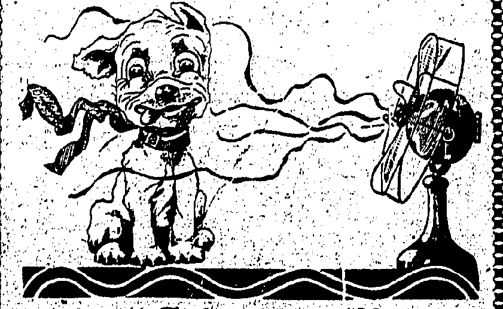

## KIDNAPPING CASE

The sequel to the alleged kid-

napping of Mr. Harry Pollitt,

secretary of the Communist or-

ganisation known as the National

Minority Movement, was heard

at Liverpool. Assizes before

Mr. Justice Fraser.

Five local men, William P.

Cochrane, 30, garage proprietor;

George F. McGachen, 30, cotton

salesman; James B. Owen, 30,

commercial traveller; James H.

Browner, 35, tailor; and John H.

Rowlandson, 26, commercial

traveller, were charged with con-

spiring to assault and unlawfully

imprison. Pollitt.

Mr. A. E. Griffith, who prosecuted, said that Mr. Pollitt, a boilermaker by trade and a trade union speaker, professing Communist beliefs and opinions, was to have addressed a meeting in Liverpool on Sunday, March 15. On the Saturday he was met at Edgehill Station, Liverpool, put into a motor care, and taken to the Liver Hotel, Rhyddalog, a village on the Flintshire moors.

Mr. Pollitt stated that at Edge-hill Station Rowlandson and Owen entered the railway compartment where he was and asked him to address a meeting at Marnaduke-street at the Communistist headquarters. He refused, but was pulled out of the train.

He was, he said, bustled through the barrier into a waiting motorcar. He made no protest at the hotel. He was asked what his financial loss had been, and he replied that he had suffered none. He did not accept any payment.

## FAME AND ADVERTISEMENT

Cross-examined by Sir Henry Curtis Bennett, K.C. (defending), Mr. Pollitt said he was a Communist speaker and had been convicted in 1921 for making alleged seritious speeches.

Sir Henry: "In fact, I might describe you as the famous Mr. Politt -Yes, and I am only quite young."

Do you find advertisement is something which is apt to make you become famous?—No. I find one becomes famous and then gets advertisement.

When Mr. Pollitt described how he was pushed into the motor-car with five other men and said one of them sat on his knee, Sir Henry Curtis Bennett asked: "In an ordinary Ford car, with six persons, somebody had to sit on somebody's knee?" "Yes," replied Mr. Pollitt, "but I don't see why it should have been my knee."

How did you recognise that these gentlemen were not comrades directly they came into the compartment at Edgehill?—First, because I had a definite understanding with my comrades to meet me at Lime street; and, second, my comrades never meet me dressed as hooligans with their caps down over their eyes, mufflers on, and their coat collars turned up. (Laughier.)

Regarding a bottle of mustard oil with which Mr. Pollitt's chest was rubbed at the inn because he had a cough, Sir Henry asked: "Was it famous because some of it got on your chest?"

Mr. Pollitt: Rowlandson rubbed my chest with it—and did it very well.

You were quite friendly with the defendants?—No, I was diplomatic. Did you toss for drinks with them and lose?—No.

## DIPLOMACY

Did you have everything you wanted, a glass of beer with your launch and so on?—Everything was quite proper.

Sir Henry suggested that far from declining financial assistance to recoup him for any loss, Mr. Pollitt received five £1 notes from the defendants.

Mr. Pollitt: I say it is a deliberate and dastardly lie. I had only $35s_{1}$ If I had had more I should have gone straight to Liverpool and exposed the whole business.

Mr. Bold, proprietor of the Liver Inn, said they appeared to be a happy party, and there was no sign that anyone was being detained against his will; and another witness said they behaved as if they were "all pals together."

Rowlandson stated in evidence that what took place was not ordered from the London headquarters of the British-Fascisti. At Edge-hill Station Mr. Pollitt made no protest. When the car broke down on the way to Shrewsbury, he gave Mr. Pollitt five £1 notes.

## BETTER THAN A SPEECH

Sir Henry Curtis Bennett, addressing the jury, described some of the allegations of Mr. Pollitt as "beautiful bits of colour put into the case, which was being brought to see whether Englishmen could get justice."

Directly Mr. Pollitt realised what was going on, he said, Mr. Pollitt agreed, and saw perhaps a far greater advertisement in the alleged kidnapping than any speech he could have delivered in Liverpool.

Mr. Justice Fraser, summing up, said it would be a most disastrous thing if in a case of that kind a man, admittedly a Communist, and admittedly a man who had made

## VISITORS AT HOTELS

Mr & Mrs A W. Van

Ardagil & child Herbischield & child

Dr W. F. Antonoury & Mrs A. Hies

Mrs d Mrs B. N. Mrs d Mrs B. J.

Roodie

## PEAK HOTEL

An aristocratic father, on being requested by a wealthy but vulgar young fellow for permission to marry one of his girls, replied:—

“Certainly. Which would you prefer—the cook or the parlour, maid?”

## LESSER KNOWN PARIS

Paris, to the majority of holiday makers, is only synonymous with Montmarre restaurants and the grey-upholstered Louis. Selze salons of the couturier, says the Paris correspondent of the "Morning Port." The shopping facilities of the Bon Marche will be the only reason for crossing the Selne, so they may even miss the Tuileries Gardens, not yet in the full splendour of their summertime herbaceous borders, or the Luxembourg terrace, where the pink and white hawthorn trees coquet with the grey stone statues of the long dead queens.

Will any one of the Easter visitors, I wonder, go so far away from such "dancings" as the "Garden of my sister" as to stroll through that old-world country town in the very heart of Paris called the Ile St Louis, and lean on the sunny stone coping of the qual to admire the house with gilt dolphin drainpipes to which perf little de Lauzun is said to have taken Le Grande Mademoiselle after their ill-assorted marriage.

The island takes its name from the saintly king who was the central figure of Thirteenth Century life in France. Paris, having been spared a great fire like the one that made Evelyn mourn "London was, but is no more," preserves an astonishing number of mediaevel buildings that few tourists ever see. Of these the best known is the most beautiful, the Sainte Chappelle, that "Most perfect monument of pure Gothic in Europe."

## CRUCIFIXION RELICS

Louis IX. commissioned Pierre de Montorcau to build him this jewelled casket as a shrine to hold the crown of thorns, the fragment of the Cross, and the metal of the lance that pierced the side of Christ, that he had bought for 100,000 francs from the needy Oriental Emperor Baudoin.

Another great monument to St. Louis is the Sorbonne, the great centre of French University life, in the rue de la Sorbonne, a street that has changed its name many times in the elastic French fashion since it was called the "Street of the Two Doors," in 1250.

The name of the college is always associated with that of Robert de Sorbonne, the almonter of St. Louis, whose disputes with that faithful Boswell, the Sire de Joinville, were among the monarch's few diversions. But it was Robert de Duai, the doctor of Queen Marguerite de Provence, who was the real founder of the Sorbonne.

He left a legacy with which Robert de Sorbonne started the little theological college that later, under the fostering care of Richelieu, grew into the vast building of to-day.

There is yet another institution, still existing in Paris, and more directly due to St. Louis's benign, violence, with a history so curious and interesting that its neglect by the majority of guide-books is "all the more inexplicable".

## 300 ULIND BEGGARS

There is no trace now left in the rue St. Honore of the original Hospice of the Quinze-Vingts, the huge caravanseral where St. Louis, lodged his three hundred blind beggars with the double object of giving them shelter and riding the streets of them. The tobacco shop of L. Civette is just where the old gateway stood till Cardinal de Rohan realised in 1779 how valuable the site had become, and how much money he could realise by its sale.

Six years before the tragic folly of the necklace affair was to shake the throne of France, the Cardinal moved the blind beggars to the old hotel of the Black Mosquitaires, a corps that had been disbanded four years previously, and in this second home, built by de Coite in 1609, their bret ren live to this day in the rue de Charenton, far from the path of the tourist.

St. Louis's dry much nearer the Grands Boulevards, but its days are doubtless numbered. Almost from the windows of that most dingy of little restaurants, on the corner of the rue Canbon and the rue St. Honore, where you may be served with food that might be equalled, but never surpassed, may be seen a deserted building that looks as if it had not been entered for many a day. Few people could tell more than that it formed part of the convent of the Dames de l'Assomption, that once stood where the big new building of the Cour des Comptes is now, but the old house is, or was a few months ago, a link with the Thirteenth Century in modern Paris.

ULYSSES RETURNS.

The story goes back to the day of Jean Haudri, the King's secretary, who started on the Crusade with St. Louis when all the inshits of the good city of Paris accompanied their beloved king as far as St. Marcel to wish him God speed. On the way back from Palestine Haudri, loitered on his way in Gallic. His wife, despating of his return, made a vow never to reenter the married state, and

Per C.P.S. R.M.S. "Empress of Russia"— on May 29th— Miss G. Archer, Father C. van Aspert, Mr. K. Akashi, Mrs L. Boyes, Mr. A. Buchanan, Mr and Mrs R. S. Breton, Mr J. A. Blake, Mrs. M. Brennan, Mr H. A. Bigclow, Miss A. Bradley-Mr F. W. Barnes, Mr F. S. Brock, man, Mr F. H. Brown, Mr and Mrs H. E. Bradley, Mr J. H. Backhouse, Mr W. Brown, Mr Chang Tse-york, Mr Chan Chee-ping, Mr D. E. Commissariat, Mrs C. H. Chen, Mrs R. Chaun, Mr F. P. Collantes, Mr Chu Jok-kwan, Mrs F. Casst-evens, Mr R. Chan, Miss C. H. Chan, Mr J. del Castillo, Mr Chan Chee-wan, Mrs John W. Craig, Mr and Mrs Chang Fat, Mr Chan Wing-to, Mrs Cheng Wan-you, Mrs S. F. Chang, Mr Y. T. Chang, Major and Mrs E. Carrion, Miss M. Carrion, Miss E. Carrion, Mr J. P. Concepcion, Mr Chan Eam-sang, Miss Dang Snae-you, Mrs T. J. Doyle, Mrs J. N. Dalton, Miss L. Dinger, Mr and Mrs I. Debourgo, Mrs R. Erdman, Capt. E. H. W. Elkington, Mr K. Behito, Mr and Mrs O. I. Ellis, Mr J. Freeman, Mr N. Fujii, Mr O. Funure, Miss Y. Fiyimoto, Mr K. Fudo, Mr Henry Sorg-frank, Mrs Geo Ket-huy, Mr Goon Fon-joe, Mr T. Goshio, Mrs E. D. Gibb, Mr H. J. Gwythe, Mr F. Gates, Dr. and Mrs C. E. Outhe, Mr A. Hebert, Mr C. R. Hus, Miss A. S. Hill, Mr T. Harne, Mr Hung Foo-san, Mr M. Heigere, Mr S. W. Hee, Mrs G. C. Hitchcock, Mrs W. A. Hicks, Mr R. R. Hind, Mr E. Hamowy, Mr K. Y. Ip, Mrs B. Jeffries, Mr K. Juro, Mr J. Jiro, Mr S. T. King, Mr K. Kayiro, Capt. E. R. M. Kirkpatrick, Mr K. Kayno, Mr F. Kojima, Mr T. Kessoku, Mrs E. H. Kreuger, Mr M. W. Koyre, Dr. S. Kishi, Mr. S. Hong, Mr G. Kagoshima, Mr. R. E. Kume-shita, Mr. D. York, Mr. Dum Chan Fau, Mr. Lee Siu Moi, Mr. C. Y. S. Leu, Mr. Y. Geo Lee Kum, Mr. S. Lopes, Mr. Lau Po Yu, Mr. Ladneff, Mr. and Mrs. A. C. Lambe, Mr. and Mrs. A. Laine, Mr. Low Yue Lan, Mr. and Mrs. Li Kuen Duck, Mrs R. J. Leutsker, Mr. C. L. M. Ma, Miss L. Martins, Mr. Mark Cheung, Mr. S. "Musumui," Mr. E. Matsutaro, Mr. T. Mitano, Mr. T. Michikata, Rev. E. Martinez, Mr. K. Merita, Mrs. S. Mujalci, Mrs. M. Muro, Mr. S. Machado, Mr. J. Findlay Milley, Mrs. B. R. Murphy, Mrs. H. J. Nall, Mr. W. Nakao, Mr. K. Noroi, Dr. S. A. Nicholson, Mr. A. Neves, Mr. S. Nakane, Mr. and Mrs. S. Ohmori, Mr. E. Onishi, Comdr. and Mrs. J. Parker, Mr. E. N. Pei, Mr. Eldon Potter, Miss S. Pudillo, Mr. S. J. Robotham, Mrs. F. W. Roberts, Miss E. C. Reid, Mr. H. A. Boyer, Mr. A. Ross, Mrs. E. Sharpe, Mrs. W. B. Sampson, Mr. I. Sakomoto, Mr. A. P. Scott, Mr. W. G. Simpson, Col. and Mrs. J. F. Siler, Mrs. A. Staton, Mr. and Mrs. R. Shilling, Mrs. S. Simmons, Mr. K. Suto, Mrs. R. Smith, Mr. and Mrs. F. Shipp, Mr. C. V. Starr, Mr. S. Sumuki, Mrs. E. P. Speight, Mr. H. P. Surrey, Mr. K. Torii, Mr. J. Tuteh, Mr. Tam Hun Kwong, Mr. S. Thomas, Mr. Tam Boo Tin, Mr. and Mrs. Teng, Mr. M. Tuji, Miss S. Todau, Mr. Titus, Mr. G. Takase, Mr. S. A. Thoumi, Mr. M. Uyemura, Mr. S. Ujiara, Mr. V. F. Vicajee, Mr. J. R. Vazquez, Mrs. T. Viera, Mr. Panelo Bor, Mr. T. Y. Wong, Mrs. W. P. Woods, Miss O. Williams, Mr. Wong Wa Foy, Mr. Wong Lai Evan, Mr. Wu Tse Chiang, Mrs. Wong and sister, Mr. Wong Shing Cheong, Mr. Wong Min Hing, Mrs. D. A. Weaver, Mrs. E. F. Wooldridge, Mr. Yick Pak, Kwai, Mr. Yung Wing Ewing, Mr. and Mrs. Kocheng Yeh, Mr. N. Yutaka, Mr. Geo. W. Yipp and Dr. A. Yates.

## DEPARTURES

The young curate was so shy that his face was crimson all the time he talked to the young American visitor. The visitor was evidently much impressed by his handsome face.

"You must see the new altar in our church," he said.

shut herself up with one or two widows to bear her company. After many years this dilatory Ulysses came back; and in order to get a dispensation for his wife to free her from her vow, he offered to pay the expenses of a religious community of twelve poor women.

After the death of this plous couple the Haudricites, as the nuns they had sheltered were called, were transferred to another home. Four centuries later the Cardinal de la Rochefoucauld gave the commission, now called de' Assomption, his own house for their convent. The huge dome, that for so many years has been left, and used for the past in the very centre of New York, was once the convent chapel, and it was here that the funeral ceremonies of the Marble de Lafayette were held. Of the convent itself, where Madandee Pompadn's daughter lived and died, there is now no trace, and the Court des Comptes conventa

## NOTICE TO SHIPPERS AND PASSENGERS

## FROM SINGAPORE

## FROM MANILA

8.-D.S.L.

9.-D.S.T.

11.-T.K.K.

21.-T.K.K.

14.-T.R.K.

27.-T.R.K.

Korea Maru

Pros. Folk

Pros. Lincoln.

Korea Maru.

Shinyo Maru

Siberia Maru

Taiyo Maru.

FROM EUROPEAN PORTS.

June. 1.-J.O.J.L. Sulbanska

5-N.Y.K. Hakozaki Maru

8.-N.Y.K. Metsuyo Maru

19.-N.Y.K. Hakosan Maru.

30.-J.O.J.L. Olderkerk

July 3.-N.Y.K. Kitano Maru

10.-N.Y.K. Matsumoto Maru

Aug. 10.-N.Y.K. Hakono Maru

14.-N.Y.K. Suwa Maru

Sept. 7. N.Y.K. Fushimi Maru

21. N.Y.K. Hakozaki Maru

Oct. 5.-N.Y.K. Hakusan Maru

19.-N.Y.K. Kitano Maru

FROM MARSHILLES.

June 8.-M.M. Angko.

10.-N.Y.K. Hakusan Maru

23.-M.M. Compiegrie

July 7.-M.M. Angero.

FROM LIVERPOOL.

June 6.-B.F. Mannor

10.-E.F. Bellerophon

11.-9.F. Troilus

11.-N.Y.K. Tijima Maru

20.-B.F. Morlones

52.-B.F. Patroclas

July 14.-N.Y.K. Levos Maru

FROM DUNKIRK.

June 30.-S.E.A.Co. Formon

FROM LONDON.

June 11.-P. & O. Kashmir

12.-H.A.L. Preussen.

14.-G.L. Glentora.

16.-N.Y.K. Kamo Maru

10.-N.Y.K. Hakcosan Maru

21.-N.L. Anhalt

23.-P. & O. Kaspgar

24.-G.L. Glentor

19.-N.L. Fulda

25.-G.L. Pembrokeshira

23.-P. & O. Maedonia

Aug. 8.-P. & O. Khyber

26.-3.L. Gleniffer.

18.-N.L. Trier

20.-P. & O. Naikund

Sept. 18.-N.L. Saarbruecken

Oct. 10.-N.L. Dassau

Nov. 7.-N.L. Coblenz

From HAMBURG.

June 21.-N.L. Anhalt

July 19.-N.L. Fulda

Aug. 16.-N.L. Trier

Sept. 18.-N.L. Saarbrocken

Oct. 10.-N.L. Dassau

Nov. 7.-N.L. Coblenz

From OCCENELGER.

June 10.-R.A. Manaya

July 15.-R.A. Tomphine

Aug. 20.-R.A. Avalon

Sept. 18.-R.A.

### GREEN ISLAND CEMENT CO., LTD

CHINA PROVIDENT LOAN & MORTGAGE COMPANY, LTD.

Advances made on Landed Property, Goods, etc.

Trustees of Estates, Executors of Wills, etc.

Warehousing of Goods of all Description.

For terms and particulars

Apply at the Head-Office,

“St. George’s” Building.

Telephone C. 781.

Telegraphic address “RELYAT.”

Telephone No. C.781.

HONGKONG TUG & LIGHTER CO., LTD.

Stevedorage and Lighterage Work undertaken.

Tugs and Lighters available at all hours.

Apply at the Head-Office,

"St. George's" Building.

Telephone No.

Chinese Branches C.4885

K. 622

## HONGKONG & TERRITORIAL ESTATES, LTD

(Property Owners, Estate Agents,

Land Valuers, etc.)

WILL UNDERTAKETHE

Development and Improvement of Landed Property and attend to all Branches of Real Estate Business.

For terms and particulars

Apply at the Head Office,

Tel. C.781.

“St. George’s” Building,

Telegraphic address “ESTATES”

BE "dog days" are coming.

Many generations ago our ancestors held the concurrent rising and setting of the dog-star with the sun to be responsible for the prevalence of hot weather for a period of forty days, twenty before and twenty after that event — a delightful climatic acrostness which the oldest man living in our village cannot recollect.

REMEMBER! A Fan in May keeps the doctor away, as it does also at any other time between the vertical and autimal squinches.

BE SURE your Electric Fan is ready for immediate use as soon as the mercury demands it.

The China Light & Power Co., (1918) Ltd.

E. Shawnman, 53 NATHAN ROAD, KOWLIPON.