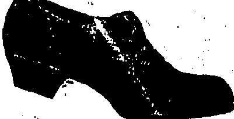
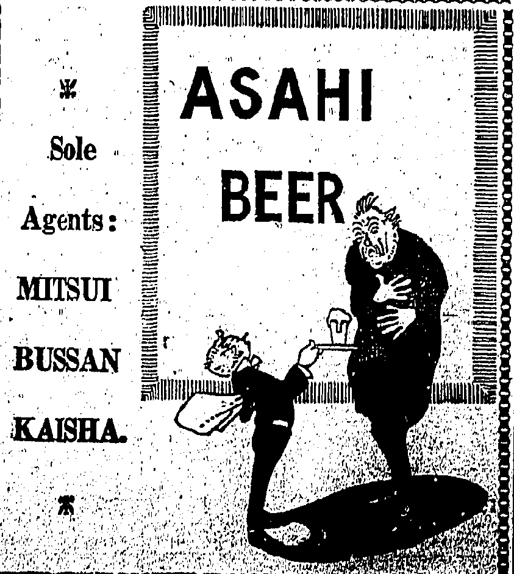
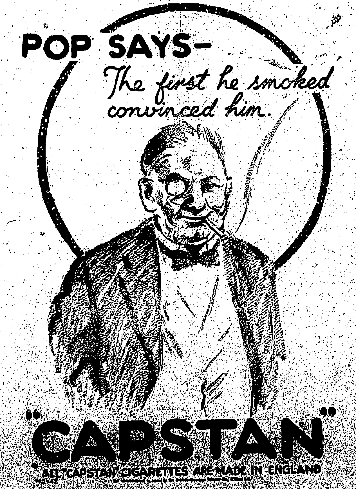

# THE CHINA MAIL.

## LAMMERT BROS

THE Undersigned have received instructions to sell by Public Auction

3 Bench Presses

68 Dos. Silk Stockings

80 Electric Table Fans

2 Pieces Overcasting

1 Treadle Sewing Machine

1 Hand Sewing Machine

255 Electric Cigars Lighters

117 Electric Iron

10 Headphones

20 Electric Cookers

280 Bones Artificial Silk Scarves and Artificial Silk Shawls

## A Large Quantity of Electric Fittings

Inverted Ceiling Lights, Bracket Lamps, Table Lamps, Sockets, Electric Wins Lamp Bulbs etc.

(for account of the concerned) One Piece White Fiannel

One Case Blankets (more or less damaged)

Terms:—Cash on delivery. LAMMERT BROM.

Teak Hatstands. Chesterfield Couch and Chairs, Dining Table, Dining Chairs, Teak Side Board with Bevelled Mirror, Dinner Waggon, Carpets, Ice Chest, Brass Ware, Crookery, Glassware, etc., etc.

Toek Single and Double Bedstands,

Toek Single and Double Wardrobes

with Bevalled Mirror, Toek Dressing

Table with Bevalled Mirror, Chest of

Drawers, Marble Top Washstand, etc.,

etc.,

And Few Pieces of Canton Blackwood Ware

On View from Monday, the 1st June 1925

Terms:—Cash on delivery. LAMMERT BRO.

## UNCLAIMED TELEGRAMS

THE GREAT NORTHERN THLE GRAPE COMPANY, LTD.

The following unclaimed telegrams are lying at the office of The Great Northern Telegraph Company (Limited):—

Stonmat, from Tokyo.

Woy Chong, from Manila.

Teaik, from Biarrity.

Tian Pit Sing, from Kobe,

Kuang Tung Shing, Chung Sht.

Chieh, from Tiantein.

3482, from Chinkiang.

Hongkong Station, 21st May, 1925.

.EASTERN EXTENSION AUSTRAL ASIA & CHINA TELEGRAPH CO.

Ardent, firm Caloutia.

Pactrust, from Medan.

Stephens, from Londonpo.

Tr Langbank, from Saigon.

E. A. LEGGATT,

C. E. WARREN & CO., LTD.

Domestic Boilers and Radiators.

Hand and Electrically Driven

Instantaneous and Automatic Gas

Water Heaters.

Tiles of every description.

## FOR SALE

YATES' PLANT FOOD, a Perfect Fertilizer, in one pound tina, sufficient for 80 to 50 POT PLANTS according to size, for one year.

Dealers in Garden Seeds, Postage

SHOEMAKERS

(Japanese Hand Made)

Every Kind of Footwear

MADE TO ORDER

HIGH CLASS TAILORING

SERVICE.

MRS. MOTONO.

ELECTRIC MASSAGE

313, Wyndham St, 2nd Floor.

# WORLD OF SPORT.

CARLISLE AND FOXGLOVE

ENTERTAINED.

It was fortunate indeed that the Carlisle and Foxglove were able to pay us a really decent visit and were not compelled to depart, as usually happens, after only 2 days, says the "B.N. Borneo Herald" Fortunately too the weather, except for a pouring wet and thundery day on the 8th, was excellent throughout, while the Easter holidays which conveniently took place at the same time gave us leisure to entertain our guests and to arrange a good programme of match fixtures, etc.

The following matches were played:

Sandakan. Sandakan won 2-1.

oth. Soccer. H.M.S. Carlisle vs. Sandakan. Carlisle won 1-0. An even game, the only goal being scored in the last few minutes.

10th. Soccer. H.M.S. Carlisle vs. H.M.S. Foxglove. Draw, 2-2. A fast game and a very delightful one to watch.

11th. Golf. Sandakan vs. H. M. Ships. Sandakan won. 5½-2½.

12th. Cricket. Sandakan and H. M. S. Foxglove vs. H. M. S. Carlisle.

First Innings. Carlisle 37. Sanda-kan and Foxglove 68 (Dearle 28). Second Innings. Carlisle 74 for 6 wickets (declared) (Courage 24, Reid 15 not out).

Sandakan and Foxglove, 21 for 4 wickets (stumps drawn 615 p.m.) The collapse of the Carlisle in the first innings was largely due to unsuccessful and over-rash attempts to make short runs, efforts which through the good fielding of the opposing team led to the dismissal of at least three valuable batmen with little or no runs to their credit. The Carlisle team also felded well, especially Surgeon Commander O'Flynn, R.N., who made two extremely fine catches.

13th, Rugger. Sandakan and H. M. S. Foxglove vs.: H. M. S. Carlisle. Sandakan and Foxglove won 17-3.

14th, H. M. S. Foxglove vs: Sandakan Asiatics. Foxglove won 2-1.

It was also found possible to cater for those who preferred the pleasures of the chase in its various forms.

Mr. Rowe conducted a party to Dewhurst Bay on the 11th in the Berhala, returning the next day. Excellent sport was from all accounts obtained and the bag included a deer whose head was quite a decent one. A herd of tembadau was also encountered but was not depleted, though the fact of meeting with these animals,

## FLYING GOLFER

440 MILES TO PLAY A GAME FOR A WAGER

Mr. R. Graham Murray, son of Lord Dunedin, one of the Lords of Appeal, makes most of his golfing expeditions by air.

He was referee of the golf match in which Sir E. Holderness and Mr. T. A. Torrance met Duncan and Mitchell at Sandy Lodge, Northwood, and in the afternoon his aeroplane was circling over the course ready for him to fly home.

Mr. Murray recently for a wager agreed to fly to Westward Hol Devon, about 220 miles, play two rounds of the championship course there, and be back in London in time for dinner the same evening. Starting at 9 a.m. he won the wager comfortably.

The flight to Westward's Ho! with a following wind took him 88 minutes.

which is by no means a certainty even in that locality, was regarded as most fortunate.

By the kind invitation of Mr. Brower, the Manager, another party spent two days on Lode Estate, and though their bag was confined to one pig they returned none the less delighted with the experience.

On the 13th a fish-bombing expedition was organised, a steam launch being generously placed at the party's disposal for the afternoon. Messrs. Garry and S. W. Matthews accompanied the expeditious, which started tamely, the first 3 charges resulting merely in a catch of a number of "tiddlers" and fish like diminutive sardines. A move was then made towards Berhala, where a splendid haul was obtained, including a number of mullet and other fish, sufficient we were told to supply the whole ship's company of the Carlisle with three or more good sized fish apiece. The last charge drew blank except for the record-Sized fish of the afternoon, an enormous mullet which we understand was much enjoyed that evening.

The Carlisle left for Hongkong on the evening of the 14th and the Foxglove for the same port at daylight on the 15th. We can assure them that we shall look forward to their return and that they, in common with the rest of H.M. Ships that have visited us this year to our great delight, will be certain of the warmest of welcomes, and we trust that on the next occasion Lieut. Commander Acland, R.N., and Paymaster Lieut. Commander Pafford, R.N., will not be, as on this occasion, confined to a bed of sickness during most of their visit.

## GOLF

The method of selecting the English and Scottish teams for the international match has been for some time a subject of discussion.

Hitherto, the predominant power in this, as in other golfing affairs; has been vested in the Royal and Ancient Club, who now feel, however, that, owing to the work which devolves upon its committee, the task should be handed over to the national unions.

"Golf Illustrated" announces that a change is likely to take place in connection with this year's contest, due to be decided on the Royal North Devon links at Westward Ho! on Saturday, May 23. It is stated that the teams will be picked by the English and Scottish Unions respectively.

## CUP-FINAL MONEY

The spectators at the Association Football Cup final between Sheffield United and Cardiff City at the Wembley Stadium is stated to have numbered about 90,000. The record attendance was in 1923, when 126,047 people paid £27,776 to see Bolton beat West Ham.

The Football Association takes one-third of the net receipts, the remainder being equally divided between the two clubs concerned in the match. The exhibition authorities receive an agreed sum for the use of the Stadium.

The Football Association's share in 1923 was £9,452, and last year, when the attendance was 91,675, £6,449.

## A PROMISING BATSMAN

Amongst the several armateurs who are expected to transfer their allegiance from one county to another this season is R. L. Holdsworth, late of Warwickshire, whose services Sussex hope to have for some of their matches. Educated at Repton and at Magdalen College, Oxford, Holdsworth was awarded his Blue in. 1913, and in the same year appeared with considerable success for Warwickshire. In his initial season of first-class cricket he scored 742 runs, with an average of 32.26, including a century for his 'Varsity against the M.C.C. at Lord's.

SHANGHAI

ASTOR HOUSE HOTEL; PALACE HOTEL; KALKE HOTEL; MAJESTIC HOTEL.

Telegraphic Address: "CENTRAL, SHANGHAI"

HOTELS,

LIMITED.

In association with the Grand Hotel

des Wagons Lits, Peking.

X

Tel. Kowloon

No. 1. PALACE HOTEL Tel. Address:

(Three minutes from Kowloon Ferry Wharf & Railway Station.)

Bathery under English Management. Electric Light & Fans Throughput.

Every Room with Private Bath.

Lounge Bar & Millard Rooms. Unrivalled Cuisine under the personal supervision of the Prophet.

Terms moderate. Special terms to families on application to J. H. OXBERRY, Prophet for

Telegraphic Address: "ASTOR." Telephone Central 178.

18, QUEEN'S ROAD CENTRAL.

A first class Hotel centrally located, large and airy rooms, completely reserved and refurbished. New Dining Room for Meals and In Carte. Excellent Cuisine. Monthly Tickets for Tbets and Dinners. Under entirely new Management.

For further particulars apply to

M. A. VAZ, Manager.

◇◇◇◇◇◇◇◇◇◇◇◇◇◇◇◇◇◇◇◇◇◇

## ◇◇◇◇◇◇◇◇◇◇◇◇◇◇◇◇◇◇◇◇◇◇◇◇◇

Commencing June 1st a Jazz Orchestra will play between 1 p.m. and 2:30 p.m. and 7 p.m. and 8 p.m.

Patrons may indulge in open-air dancing on the roof which is exceptionally cool during the summer months.

The best Chinese meals are served at all times.

An additional charge of 50 cents each, will be made for dancing

Telephone 0.4682.

☐☐☐☐☐☐☐☐☐☐☐☐☐☐☐☐☐☐☐☐☐☐☐☐☐

## X

## ADELPHI HOTEL

This distinguished Hotel in the heart of Singapore's social life, with its commanding position facing the beautiful Cathedral Grounds and Sea, offers you complete hospitality and comfort in a refined atmosphere.

Unsurpassed for Meals. Excellent Wines.

Orchestra Daily during

and After Dinner.

Cables: Adelphi Phone: 937, 938

ADELPHI HOTEL LTD.

HARRY H. WILLIES,

Managing Director

## NATIONAL GEOGRAPHY OF THE WORLD

☀️🌙🌙🌙🌙🌙🌙🌙🌙🌙🌙🌙🌙🌙🌙🌙🌙🌙🌙🌙🌙🌙

SUKIYAKI HALL

JUST OPENED

TRY SUKIYAKI and TORINABE OHOW,

Best Food at the Chespest Price.

CHITOSE HOTEL. Branch. Tel. C. 1716.

No. 1 Han Fun Lane (Near Chinese Temple Queen's Road East, Wanchal.

MASSAGE

Mr SEIMIDZU

Mrs HONDA

No 14, Wyndham Street